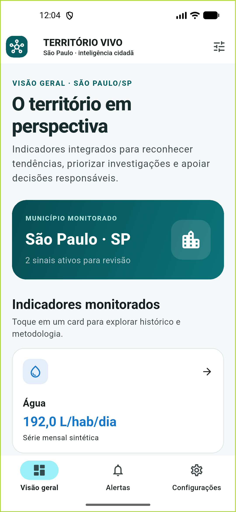
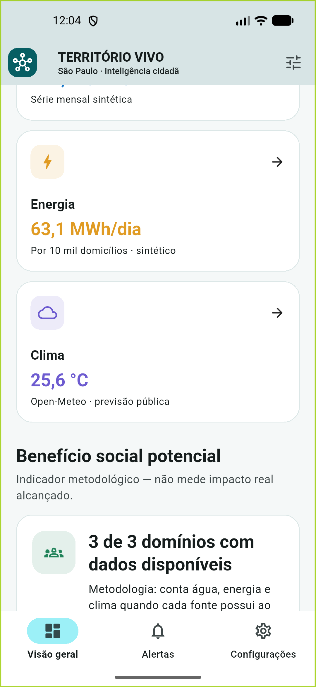
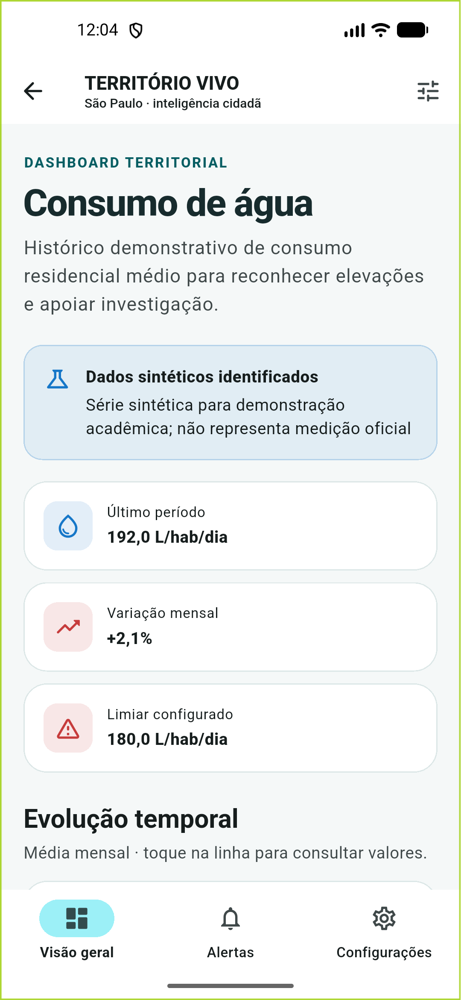
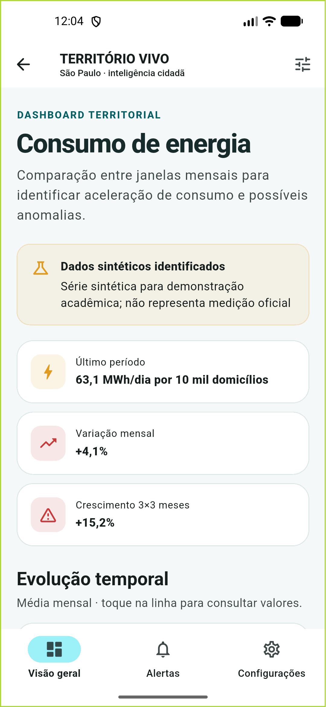
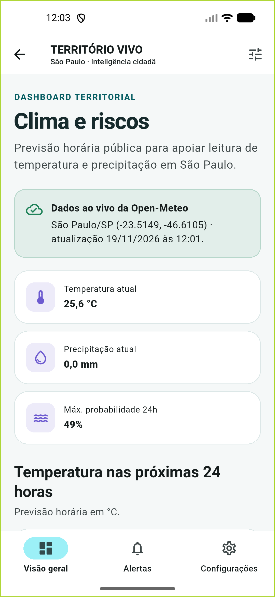
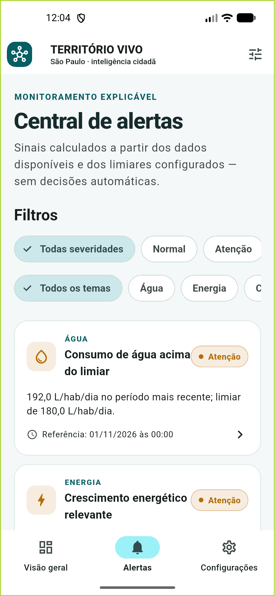
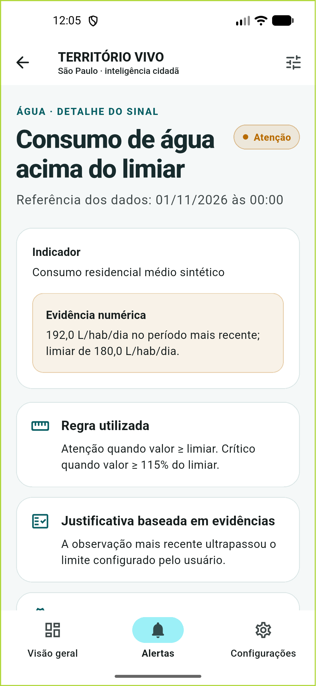
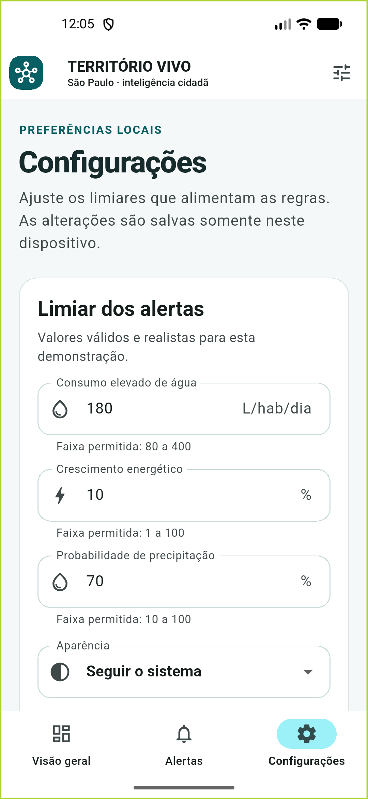

# 1. Território Vivo

<p align="center">
  
</p>

**Território Vivo** é um aplicativo Flutter de inteligência territorial para São Paulo/SP, desenvolvido para a Global Solution 2026.2 da FIAP. Ele integra séries demonstrativas de água e energia à previsão pública de clima, produzindo sinais transparentes que apoiam — e nunca substituem — decisões humanas.

## 2. Problema, público-alvo e impacto social

Indicadores urbanos costumam estar dispersos, ter periodicidades diferentes e chegar aos responsáveis sem uma explicação clara de por que determinado ponto merece atenção. O aplicativo organiza esses sinais em uma experiência mobile compreensível.

O público-alvo inclui gestores públicos, equipes técnicas, conselhos locais e cidadãos interessados em acompanhar o território. O benefício social exibido no app é uma **métrica de cobertura informacional**: quantos dos três domínios possuem ao menos uma observação utilizável. Ela não afirma economia gerada, pessoas beneficiadas ou impacto causal ainda não medido.

## 3. Integrantes

| Nome | RM |
|---|---|
| Amom Ianaguivara Brito | 565718 |
| Fernando Antônio | 562549 |
| Victor Chen | 565363 |

## 4. Demonstração visual

Imagens capturadas do aplicativo

| Consentimento | Visão geral | Indicadores e benefício social |
|---|---|---|
|  |  |  |

| Água | Energia | Clima |
|---|---|---|
|  |  |  |

| Central de alertas | Detalhe explicável | Configurações |
|---|---|---|
|  |  |  |

## 5. Checklist das funcionalidades implementadas

- [x] Experiência inicial de consentimento com aceite ou recusa de opcionais.
- [x] Visão geral do território e indicador de benefício social metodológico.
- [x] Dashboard de água com série sintética, gráfico, variação e limiar.
- [x] Dashboard de energia com série sintética e comparação entre janelas 3×3.
- [x] Dashboard climático com Open-Meteo, atualização, origem e cache.
- [x] Central de alertas dinâmica com severidade e filtros funcionais.
- [x] Estado vazio quando os filtros não encontram resultados.
- [x] Detalhe com evidência, regra, confiança, limitações e recomendação.
- [x] Formulário validado e persistência local de limiares e tema.
- [x] Recalculo dos alertas após mudança de configuração.
- [x] Tema claro, escuro ou conforme o sistema.
- [x] Loading, erro, nova tentativa, sucesso e funcionamento offline por cache.
- [x] Semântica, texto além de cores e layouts flexíveis para acessibilidade.
- [x] Testes automatizados das regras, validação, persistência e consentimento.

## 6. Dados, alertas, métricas, limitações e vieses

### Fontes de dados

- **Clima:** API pública [Open-Meteo](https://open-meteo.com/), sem chave, para o ponto aproximado de São Paulo/SP. A resposta bem-sucedida é persistida localmente. Em falha de rede, timeout, status HTTP inválido ou JSON inválido, o app usa o último cache; sem cache, mostra indisponibilidade real.
- **Água:** `assets/data/water_history.json`, série mensal sintética em L/hab/dia.
- **Energia:** `assets/data/energy_history.json`, série mensal sintética em MWh/dia por 10 mil domicílios.

Água e energia são identificadas em todas as telas como **dados sintéticos acadêmicos**. Não são apresentadas como medições oficiais.

### Regras dos alertas

| Domínio | Atenção | Crítico |
|---|---|---|
| Água | Último valor ≥ limiar configurado | Último valor ≥ 115% do limiar |
| Energia | Crescimento da média dos 3 últimos meses sobre os 3 anteriores ≥ limiar | Crescimento ≥ limiar + 10 pontos percentuais |
| Clima | Máxima probabilidade de precipitação nas próximas 24 h ≥ limiar | Máxima ≥ limiar + 20 p.p., limitada a 100% |

A confiança é qualitativa, não uma probabilidade calibrada. Para água e energia ela considera completude da janela, mas permanece média por serem séries sintéticas. Para clima ela é alta com 24 pontos ao vivo, média com janela completa em cache e baixa com janela incompleta.

### Limitações e vieses

- O ponto climático central não representa a variação entre bairros.
- Previsões mudam e não substituem Defesa Civil ou fontes oficiais.
- Séries sintéticas não modelam população, sazonalidade, perdas de rede, temperatura, tarifa ou atividade econômica.
- Dados agregados podem ocultar desigualdades territoriais.
- As regras detectam relação com limiares; não explicam causalidade nem executam decisões.

## 7. Privacidade, consentimento e acessibilidade

O aplicativo não solicita nome, documento, endereço individual ou outro dado pessoal. Preferências, consentimento e cache ficam no armazenamento local via `shared_preferences`. A opção de diagnósticos anônimos está desativável e, nesta versão acadêmica, nenhuma telemetria é transmitida.

A interface usa contraste, ícones e texto para severidade, alvos de toque com rótulos semânticos, navegação previsível e componentes flexíveis para aumento de fonte. Nenhuma ação de alto impacto ocorre automaticamente; o detalhe do alerta reafirma a responsabilidade humana.

## 8. Tecnologias, arquitetura e justificativas

| Tecnologia | Uso e justificativa |
|---|---|
| Flutter 3.47.3 / Dart 3.13.3 | Base cross-platform e Material Design 3. |
| `go_router` 18.1.4 | Rotas nomeadas, parâmetros e shell de navegação. |
| `flutter_riverpod` 3.5.0 | Estado compartilhado, assíncrono e testável. |
| `fl_chart` 1.3.1 | Gráficos temporais interativos e leves. |
| `http` 1.6.0 | Cliente explícito para Open-Meteo com timeout. |
| `shared_preferences` 2.5.6 | Preferências, consentimento e cache JSON persistente. |
| `intl` 0.20.3 | Datas e números em português brasileiro. |

Arquitetura adotada:

```text
lib/
├── app/            # MaterialApp, tema e roteamento
├── core/           # Formatação compartilhada
├── data/           # Fontes locais, HTTP e preferências
├── features/       # Telas por domínio funcional
│   ├── alerts/
│   ├── dashboards/
│   ├── onboarding/
│   ├── overview/
│   └── settings/
├── models/         # Entidades tipadas
├── providers/      # Estado e injeção com Riverpod
├── repositories/   # Coordenação de fontes e fallback
├── services/       # Regras determinísticas e validação
└── widgets/        # Componentes visuais reutilizáveis
```

O estado compartilhado (dados, limiares, clima e alertas) está nos providers. Filtros da central permanecem como estado local de interface. Essa separação evita acoplamento e faz alterações nos limiares repercutirem em todas as telas.

## 9. Como executar

### Pré-requisitos

- Flutter SDK compatível (validado com 3.47.3 stable).
- Android SDK, licenças aceitas e um emulador configurado.
- VS Code com as extensões Flutter e Dart.

### Terminal

```powershell
cd C:\Projetos\gs_cross_plat
C:\devflutter\flutter\bin\flutter.bat pub get
C:\devflutter\flutter\bin\flutter.bat devices
C:\devflutter\flutter\bin\flutter.bat run
```

### VS Code e emulador

1. Abra `C:\Projetos\gs_cross_plat` no VS Code.
2. Abra a paleta com `Ctrl+Shift+P` e execute **Flutter: Launch Emulator**.
3. Escolha um AVD, por exemplo `Pixel_5`.
4. Aguarde o dispositivo aparecer na barra inferior do VS Code.
5. Abra `lib/main.dart`.
6. Pressione `F5` ou acesse **Run > Start Debugging**.
7. No primeiro acesso, escolha aceitar ou recusar os dados opcionais.

### Validação executada neste workspace

```text
flutter pub get       → concluído
dart format lib test  → 33 arquivos formatados
flutter analyze       → No issues found!
flutter test          → 11 testes aprovados
flutter build apk --debug → APK gerado com sucesso
flutter run -d emulator-5554 --debug --no-resident → instalado e iniciado no Pixel 5
flutter run -d emulator-5556 --debug --no-resident → instalado e iniciado no Pixel 2
```

APK de debug: `build/app/outputs/flutter-apk/app-debug.apk` (artefato local ignorado pelo Git).

## 10. Vídeo demonstrativo

**Link:** https://youtu.be/qPUhlYgkXcg

## 11. Licença e identificação acadêmica

Distribuído sob a [Licença MIT](LICENSE).

Projeto acadêmico da disciplina **Cross-Platform Application Development**, Global Solution **2026.2**, tema **CitizenTech**, desafio **Territory Predictive Insights**, FIAP. O aplicativo é uma demonstração educacional e não constitui sistema oficial de monitoramento ou recomendação pública.
